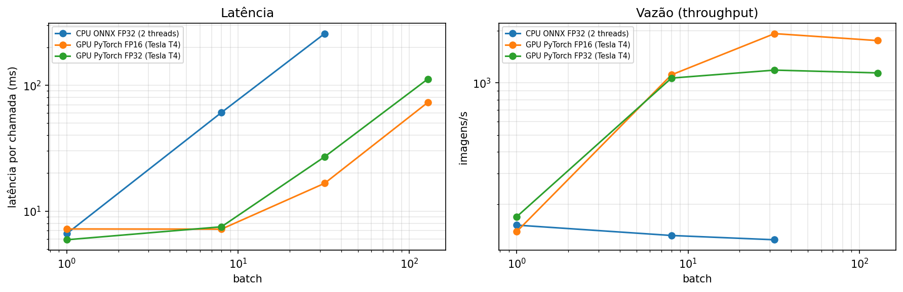

# Deep Learning Portfolio: visão computacional eficiente para dispositivos móveis

Portfólio de deep learning com uma trilha que vai **dos fundamentos (backprop escrito à mão) até a otimização de um modelo para rodar em celular**: quantização INT8, ONNX, pruning e benchmark de latência.


---

## Projeto principal: classificador de raças de pets otimizado para mobile

Classificação de **37 raças de cães e gatos** ([Oxford-IIIT Pet](https://www.robots.ox.ac.uk/~vgg/data/pets/)) com **MobileNetV3-Large**. O modelo é treinado com *transfer learning* e depois otimizado para inferência em CPU de dispositivos móveis.

| Notebook | Conteúdo |
|---|---|
| [03 · Transfer learning](notebooks/03_projeto_transfer_learning_mobilenetv3.ipynb) | *Fine-tuning* em duas fases, LR por grupo de camadas, AMP, avaliação top-1/top-5, análise de erros, **Grad-CAM** implementado do zero e **registro de experimentos** (configuração, TensorBoard, melhor modelo) |
| [04 · Otimização para mobile](notebooks/04_projeto_otimizacao_mobile.ipynb) | **TorchScript**, exportação **ONNX**, quantização **INT8 dinâmica e estática (QDQ, por canal)**, **diagnóstico de outliers de ativação** e quantização mista / **W8A16**, **pruning** L1 global e benchmark de latência, tamanho e acurácia. **Análise de performance:** MACs × latência em 6 arquiteturas, escalabilidade com threads e o trade-off entre batch, latência e vazão em CPU × GPU (FP32/FP16) |

### Resultados

**Treino:** a MobileNetV3-Large com *fine-tuning* chegou a **90,2% de top-1** no conjunto de teste (37 raças, 3.669 imagens). A validação ficou em ~93% já depois da fase 1, só com a cabeça treinada, e chegou a 94% no *fine-tuning*. A acurácia de treino foi a 99,9%, um sinal de que mais épocas não ajudariam sem mais regularização.

> Benchmark medido no Google Colab, em CPU Intel Xeon @ 2.00GHz, com **batch 1 e 1 thread**, mediana de 100 execuções. Acurácia no conjunto de teste completo. Dados brutos em [`results/`](results/).

| modelo | tamanho (MB) | latência p50 (ms) | top-1 | speedup | Δ top-1 (p.p.) |
|---|---|---|---|---|---|
| PyTorch FP32 (*eager*) | 17,2 | 36,9 | 90,2% | 1,0× | 0,0 |
| TorchScript FP32 | 17,0 | 12,7 | 90,2% | 2,9× | 0,0 |
| **ONNX Runtime FP32** | 17,0 | **6,6** | 90,2% | **5,6×** | 0,0 |
| ONNX INT8 dinâmico | 4,5 | 32,2 | 54,6% | 1,1× | −35,7 |
| ONNX INT8 estático (ingênuo) | 4,8 | 9,7 | **2,6%** | 3,8× | **−87,6** |
| ONNX INT8 misto (51 nós em FP32) | 8,9 | 9,2 | 65,2% | 4,0× | −25,1 |
| **ONNX W8A16** | **4,8** | 31,6 | **90,3%** | 1,2× | **0,0** |


**Principais aprendizados:**
- **O runtime importa muito:** sem mexer no modelo, trocar o PyTorch *eager* pelo ONNX Runtime deixou a inferência **5,6× mais rápida** (36,9 → 6,6 ms).
- **Quantização não é um botão.** O INT8 estático "ingênuo" **destruiu** o modelo (90% → 2,6%). Investiguei com análise de sensibilidade por bloco e estatísticas de ativação: poucos canais, nas conexões residuais e nas convoluções *depthwise*, chegam a valores dezenas de vezes acima do percentil 99,9%, e isso esmaga a resolução dos 8 bits (seção 5b do notebook 04).
- **Cada correção tem um custo diferente:** o **W8A16** (pesos em 8 bits, ativações em 16) recupera **100% da acurácia** com o arquivo 3,6× menor, mas nesta CPU, sem kernels de 16 bits, fica lento. Ele faz sentido em NPUs com suporte nativo a esse formato. O INT8 misto mantém a velocidade, mas só recupera parte da acurácia. O próximo passo seria *quantization-aware training*.
- **Pruning não estruturado comprime o arquivo, mas não acelera:** com 20% dos pesos zerados, a perda é de 0,5 p.p.; com 40%, de 8,5 p.p.; com 50%, o modelo colapsa (90,5% → 39,3%). A latência fica igual (~20 ms), porque as matrizes continuam densas.

### Análise de performance



- **MACs não preveem latência:** a ResNet-50 faz **72× mais operações** que a MobileNetV3-Small, mas é só **12,5× mais lenta**. Cada bilhão de operações custa ~179 ms na MobileNetV3-Small e ~31 ms na ResNet-50: as convoluções *depthwise* fazem poucas contas por byte lido, e a memória vira o gargalo.
- **Latência × vazão:** na CPU, aumentar o batch não aumenta a vazão (~125–150 imagens/s). Na GPU T4, com batch 1, a latência é parecida com a da CPU (5,9 vs. 6,6 ms), mas com batch 32 a vazão chega a **1.185 imagens/s em FP32** e **1.925 em FP16** (+62%, Tensor Cores). Para um app de câmera em tempo real (batch 1), a GPU não traz vantagem; para processar lotes de fotos, ela é muito melhor.
- **Threads:** no Colab, 2 threads não trouxeram ganho (1,01×). As 2 vCPUs provavelmente são dois *hyperthreads* do mesmo núcleo físico. Isso mostra por que é preciso medir no hardware de destino.

---

## Fundamentos

| Notebook | Conteúdo |
|---|---|
| [01 · MLP do zero](notebooks/01_fundamentos_mlp_numpy_vs_pytorch.ipynb) | MLP em **NumPy puro**: forward, backprop manual, SGD com momentum, **gradient check** e comparação dos gradientes com o autograd do PyTorch (MNIST) |
| [02 · CNN residual](notebooks/02_cnn_cifar10.ipynb) | ResNet pequena treinada do zero no CIFAR-10: augmentation, OneCycleLR, label smoothing, **mixed precision**, matriz de confusão, erros de alta confiança, throughput e registro de experimentos no **TensorBoard** |

## Competências demonstradas

- **Deep learning:** backpropagation, CNNs, conexões residuais, BatchNorm, regularização, agendamento de LR, *transfer learning*
- **Visão computacional:** classificação *fine-grained*, data augmentation, interpretabilidade (Grad-CAM)
- **Otimização e deploy:** TorchScript, ONNX, ONNX Runtime, quantização pós-treino (dinâmica/estática, por canal), pruning e metodologia de benchmark (aquecimento, mediana/p90, threads fixas)
- **Análise de performance:** latência × vazão, efeito do batch e das threads, CPU × GPU, FP32 × FP16 × INT8, e por que MACs não preveem latência
- **Experimentos reproduzíveis:** configuração centralizada e salva por execução, TensorBoard (curvas e comparação de hiperparâmetros), melhor modelo salvo pela validação
- **Ferramentas:** PyTorch, torchvision, ONNX Runtime, TensorBoard, NumPy, scikit-learn, pandas, Matplotlib, Git

## Como executar

**Google Colab (recomendado):** clique no botão "Abrir no Colab" no topo de cada notebook e selecione *GPU T4*. Os notebooks 03 e 04 usam o Google Drive para passar o checkpoint de um para o outro (`MyDrive/dl-portfolio/artifacts`).

**Localmente:**

```bash
pip install -r requirements.txt
jupyter lab notebooks/
```

Todos os notebooks aceitam `SMOKE_TEST=1` (variável de ambiente), que roda uma versão bem reduzida para testar o código em minutos.

## Estrutura

```
notebooks/   notebooks 01–04
results/     tabelas e gráficos finais (benchmark)
tools/       scripts que geram os notebooks
```

## Como este projeto foi desenvolvido

Usei um assistente de IA (Claude) como apoio para estruturar os notebooks e escrever parte do código, do mesmo jeito que se usa documentação, tutoriais ou um colega mais experiente. Minha parte:

- **Escolhas do projeto:** foco em visão computacional eficiente para mobile, escolha da MobileNetV3, das técnicas de otimização e do protocolo de benchmark
- **Execução e análise:** rodei todos os experimentos no Google Colab, interpretei os resultados e escrevi as conclusões a partir dos números obtidos
- **Estudo do código:** revisei e entendi cada etapa (backprop, transfer learning, Grad-CAM, quantização e pruning)
- _[descreva aqui o que você mudou ou acrescentou, por exemplo: "testei calibração Percentile vs. MinMax e a acurácia do INT8 estático variou X p.p."]_

Acredito que usar IA de forma transparente e crítica faz parte de desenvolver IA de forma responsável.

## Próximos passos

- Benchmark em celular real (ONNX Runtime Mobile / ExecuTorch) usando NNAPI, Core ML e GPU (sistemas heterogêneos)
- *Quantization-aware training* (QAT) e pruning estruturado com *fine-tuning*
- Distilação de conhecimento (ResNet-50 como professor da MobileNetV3)
