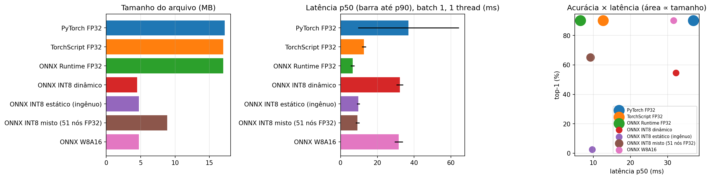

# Deep Learning Portfolio: visão computacional eficiente para dispositivos móveis

Portfólio de deep learning com uma trilha que vai **dos fundamentos (backprop escrito à mão) até a otimização de um modelo para rodar em celular**: quantização INT8, ONNX, pruning e benchmark de latência.

**Autor(a):** [Seu nome] · [LinkedIn] · [e-mail] · graduação em [curso], [instituição]

---

## Projeto principal: classificador de raças de pets otimizado para mobile

Classificação de **37 raças de cães e gatos** ([Oxford-IIIT Pet](https://www.robots.ox.ac.uk/~vgg/data/pets/)) com **MobileNetV3-Large**. O modelo é treinado com *transfer learning* e depois otimizado para inferência em CPU de dispositivos móveis.

| Notebook | Conteúdo |
|---|---|
| [03 · Transfer learning](notebooks/03_projeto_transfer_learning_mobilenetv3.ipynb) | *Fine-tuning* em duas fases, LR por grupo de camadas, AMP, avaliação top-1/top-5, análise de erros, **Grad-CAM** implementado do zero e **registro de experimentos** (configuração, TensorBoard, melhor modelo) |
| [04 · Otimização para mobile](notebooks/04_projeto_otimizacao_mobile.ipynb) | **TorchScript**, exportação **ONNX**, quantização **INT8 dinâmica e estática (QDQ, por canal)**, **pruning** L1 global e benchmark de latência, tamanho e acurácia. **Análise de performance:** MACs × latência em 6 arquiteturas, escalabilidade com threads e o trade-off entre batch, latência e vazão em CPU × GPU (FP32/FP16) |

### Resultados

> Medido em CPU, **batch 1, 1 thread**, mediana de 100 execuções; acurácia no conjunto de teste completo (3.669 imagens).
> CPU: _[preencher com a saída do notebook 04]_

| modelo | tamanho (MB) | latência p50 (ms) | top-1 | speedup | Δ top-1 (p.p.) |
|---|---|---|---|---|---|
| PyTorch FP32 | _ | _ | _ | 1.00 | 0.00 |
| TorchScript FP32 | _ | _ | _ | _ | _ |
| ONNX Runtime FP32 | _ | _ | _ | _ | _ |
| ONNX INT8 dinâmico | _ | _ | _ | _ | _ |
| ONNX INT8 estático (QDQ) | _ | _ | _ | _ | _ |

<!-- Depois de rodar o notebook 04: cole aqui a tabela que ele imprime e salve o gráfico benchmark.png em results/ -->
<!--  -->

**Principais aprendizados:**
- _[2 ou 3 frases com as suas conclusões, escritas a partir dos números acima]_

---

## Fundamentos

| Notebook | Conteúdo |
|---|---|
| [01 · MLP do zero](notebooks/01_fundamentos_mlp_numpy_vs_pytorch.ipynb) | MLP em **NumPy puro**: forward, backprop manual, SGD com momentum, **gradient check** e comparação dos gradientes com o autograd do PyTorch (MNIST) |
| [02 · CNN residual](notebooks/02_cnn_cifar10.ipynb) | ResNet pequena treinada do zero no CIFAR-10: augmentation, OneCycleLR, label smoothing, **mixed precision**, matriz de confusão, erros de alta confiança, throughput e registro de experimentos no **TensorBoard** |

## Competências demonstradas

- **Deep learning:** backpropagation, CNNs, conexões residuais, BatchNorm, regularização, agendamento de LR, *transfer learning*
- **Visão computacional:** classificação *fine-grained*, data augmentation, interpretabilidade (Grad-CAM)
- **Otimização e deploy:** TorchScript, ONNX, ONNX Runtime, quantização pós-treino (dinâmica/estática, por canal), pruning e metodologia de benchmark (aquecimento, mediana/p90, threads fixas)
- **Análise de performance:** latência × vazão, efeito do batch e das threads, CPU × GPU, FP32 × FP16 × INT8, e por que MACs não preveem latência
- **Experimentos reproduzíveis:** configuração centralizada e salva por execução, TensorBoard (curvas e comparação de hiperparâmetros), melhor modelo salvo pela validação
- **Ferramentas:** PyTorch, torchvision, ONNX Runtime, TensorBoard, NumPy, scikit-learn, pandas, Matplotlib, Git

## Como executar

**Google Colab (recomendado):** clique no botão "Abrir no Colab" no topo de cada notebook e selecione *GPU T4*. Os notebooks 03 e 04 usam o Google Drive para passar o checkpoint de um para o outro (`MyDrive/dl-portfolio/artifacts`).

**Localmente:**

```bash
pip install -r requirements.txt
jupyter lab notebooks/
```

Todos os notebooks aceitam `SMOKE_TEST=1` (variável de ambiente), que roda uma versão bem reduzida para testar o código em minutos.

## Estrutura

```
notebooks/   notebooks 01–04
results/     tabelas e gráficos finais (benchmark)
tools/       scripts que geram os notebooks
```

## Como este projeto foi desenvolvido

Usei um assistente de IA (Claude) como apoio para estruturar os notebooks e escrever parte do código, do mesmo jeito que se usa documentação, tutoriais ou um colega mais experiente. Minha parte:

- **Escolhas do projeto:** foco em visão computacional eficiente para mobile, escolha da MobileNetV3, das técnicas de otimização e do protocolo de benchmark
- **Execução e análise:** rodei todos os experimentos no Google Colab, interpretei os resultados e escrevi as conclusões a partir dos números obtidos
- **Estudo do código:** revisei e entendi cada etapa (backprop, transfer learning, Grad-CAM, quantização e pruning)
- _[descreva aqui o que você mudou ou acrescentou, por exemplo: "testei calibração Percentile vs. MinMax e a acurácia do INT8 estático variou X p.p."]_

Acredito que usar IA de forma transparente e crítica faz parte de desenvolver IA de forma responsável.

## Próximos passos

- Benchmark em celular real (ONNX Runtime Mobile / ExecuTorch) usando NNAPI, Core ML e GPU (sistemas heterogêneos)
- *Quantization-aware training* (QAT) e pruning estruturado com *fine-tuning*
- Distilação de conhecimento (ResNet-50 como professor da MobileNetV3)
