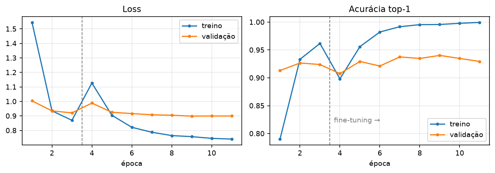
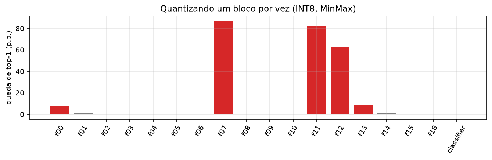
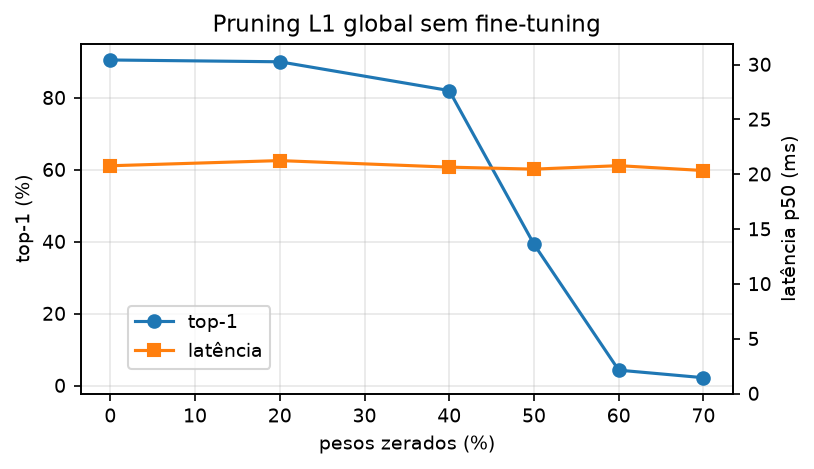
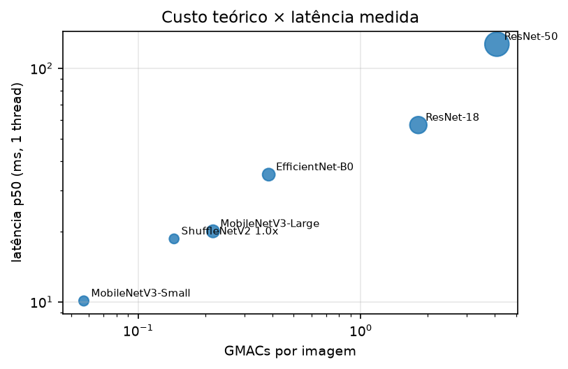

# Classificação eficiente de imagens para dispositivos móveis: *transfer learning*, quantização e análise de performance da MobileNetV3

**Maria Luísa Brandão** · Universidade Federal de Pernambuco (UFPE)
*Relatório técnico, outubro de 2026*

---

## Resumo

Este trabalho estuda o caminho completo entre treinar um classificador de imagens e deixá-lo pronto para rodar com eficiência em hardware com recursos limitados. Uma MobileNetV3-Large pré-treinada no ImageNet foi ajustada com *transfer learning* em duas fases para classificar 37 raças de cães e gatos (Oxford-IIIT Pet), chegando a **90,2% de top-1** e **99,2% de top-5** no conjunto de teste. Em seguida, o modelo foi convertido para TorchScript e ONNX, quantizado e podado, e cada variante foi medida em tamanho, latência e acurácia com um protocolo controlado. Só a troca do *runtime* reduziu a latência em **5,6×** (36,9 → 6,6 ms em 1 thread de CPU), sem perda de acurácia. A quantização estática INT8 convencional, por outro lado, **derrubou a acurácia para 2,6%**. Uma análise de sensibilidade por bloco e de estatísticas de ativação mostrou a causa: **outliers de ativação** concentrados em poucos canais das conexões residuais e das convoluções *depthwise*, que chegam a mais de 100× o valor típico. Com pesos em 8 bits e ativações em 16 bits (**W8A16**), a acurácia original foi recuperada (90,3%) e o arquivo ficou 3,6× menor. Uma análise complementar mostra que o número de operações (MACs) não prevê a latência, e que a escolha entre CPU e GPU depende do regime de uso (latência × vazão).

**Palavras-chave:** visão computacional, inferência eficiente, quantização, MobileNetV3, ONNX Runtime, análise de performance.

---

## 1. Introdução

Rodar redes neurais em celulares e sistemas embarcados exige equilibrar três grandezas que competem entre si: **acurácia**, **latência** e **tamanho** do modelo. Arquiteturas como a MobileNetV3 [1] foram projetadas para esse cenário, mas a arquitetura é só parte do problema. O formato de execução, a precisão numérica e o hardware de destino alteram o custo real da inferência em uma ordem de grandeza.

O objetivo deste trabalho é medir, num caso realista, o efeito de cada etapa do caminho do treino até o *deploy*:

1. treinar um classificador *fine-grained* com poucos dados, usando *transfer learning*;
2. comparar *runtimes* (PyTorch *eager*, TorchScript, ONNX Runtime);
3. aplicar e **diagnosticar** técnicas de compressão (quantização e *pruning*);
4. analisar como a latência depende da arquitetura, do tamanho do batch, do número de threads e do processador (CPU × GPU).

A principal contribuição é a investigação da falha da quantização INT8. Em vez de tratar a quantização como uma etapa automática, o trabalho mostra como localizar a origem da degradação e como diferentes correções trocam acurácia, tamanho e latência entre si.

## 2. Fundamentação

**MobileNetV3** [1]. Usa blocos *inverted residual* com convoluções *depthwise separable*, *squeeze-and-excitation* e a ativação *hard-swish*, uma aproximação barata da *swish*. A versão Large tem 5,5 M de parâmetros e 0,22 GMACs por imagem de 224×224, contra 25,6 M e 4,1 GMACs da ResNet-50.

**Quantização** [2, 3, 6]. Representa pesos e ativações com inteiros de poucos bits. Na forma afim, um valor real $x$ é aproximado por

$$\hat{x} = s \cdot \left(\mathrm{clip}\!\left(\mathrm{round}(x/s) + z,\ 0,\ 2^b - 1\right) - z\right),$$

onde $s$ é a escala, $z$ o *zero point* e $b$ o número de bits. Na quantização **estática**, $s$ e $z$ das ativações são fixados antes, a partir de um conjunto de calibração. Com calibração *MinMax*, $s = (\max - \min)/(2^b - 1)$: **um único valor extremo aumenta o passo de quantização para todos os outros valores do tensor**. Na **dinâmica**, só os pesos são pré-quantizados, e as ativações são quantizadas em tempo de execução.

**Pruning** [7]. Zera os pesos de menor magnitude. O pruning não estruturado reduz o tamanho do arquivo comprimido, mas só acelera a inferência com kernels esparsos ou com a remoção de estruturas inteiras (canais, filtros).

**Custo teórico × custo real.** O número de multiplicações e acúmulos (MACs) ignora o custo de mover dados. Pelo modelo *roofline* [10], operações com baixa intensidade aritmética, como as convoluções *depthwise*, são limitadas pela largura de banda da memória, e não pela capacidade de cálculo.

## 3. Metodologia

### 3.1 Dados

Oxford-IIIT Pet [5]: 37 raças, divisão oficial de 3.680 imagens de `trainval` e 3.669 de `test`. O `trainval` foi dividido em 90% para treino e 10% para validação, com semente fixa. **O conjunto de teste só foi usado para os números finais.**

### 3.2 Treinamento

MobileNetV3-Large com pesos do ImageNet, com a última camada trocada para 37 classes. O treino teve duas fases:

| | Fase 1: *linear probing* | Fase 2: *fine-tuning* |
|---|---|---|
| Parâmetros treinados | só o classificador (BatchNorm do backbone congelado) | todos |
| Épocas | 3 | 8 |
| Otimizador | AdamW, LR 1e-3 | AdamW, LR 1e-4 (backbone) e 1e-3 (classificador), OneCycle |

Configuração comum às duas fases: batch 64, *weight decay* 1e-4, *label smoothing* 0,1 [12], *mixed precision* (AMP) [8] em GPU Tesla T4. *Augmentation*: `RandomResizedCrop` (escala 0,6–1,0), *flip* horizontal e *color jitter* 0,2.

### 3.3 Variantes otimizadas

- **TorchScript:** grafo capturado por *tracing* e congelado com `freeze`.
- **ONNX Runtime FP32:** exportação com opset 17, verificada contra o PyTorch (diferença máxima de ~1e-6 nos *logits*).
- **INT8 dinâmico:** `quantize_dynamic` do ONNX Runtime.
- **INT8 estático:** formato QDQ, pesos int8 por canal, ativações uint8 por tensor, calibração MinMax com 256 imagens de **treino**.
- **INT8 misto e W8A16:** correções descritas na Seção 4.3.
- ***Pruning*:** L1 global não estruturado sobre convoluções e camadas lineares, de 0 a 70%, sem retreino.

### 3.4 Protocolo de benchmark

As medições foram feitas no Google Colab (CPU Intel Xeon @ 2,0 GHz com 2 vCPUs, GPU Tesla T4; PyTorch 2.11, ONNX Runtime 1.31):

- **latência:** batch 1 e **1 thread**, 20 execuções de aquecimento e **mediana (p50)** e p90 de 100 execuções;
- **acurácia:** top-1 no conjunto de teste completo, igual para todas as variantes;
- **tamanho:** arquivo em disco.

Ficar em 1 thread aproxima o cenário de um núcleo de celular e reduz o ruído causado pelo escalonamento entre núcleos.

## 4. Resultados

### 4.1 Treinamento

A validação chegou a ~93% de top-1 já depois da fase 1 e a um pico de 94,0% durante o *fine-tuning* (Fig. 1). No **teste**, o modelo final teve **90,2% de top-1** e **99,2% de top-5**. A acurácia de treino chegou a 99,9% enquanto a de validação se estabilizou, o que indica que mais épocas não trariam ganho sem mais regularização.

*Figura 1: loss e acurácia por época. A linha tracejada marca o início do fine-tuning.*

### 4.2 Runtime e compressão

Para inspeção qualitativa, o notebook de treino também inclui mapas de **Grad-CAM** [9], implementados do zero, que mostram as regiões da imagem que mais pesam em cada predição.

**Tabela 1:** variantes do modelo (CPU, batch 1, 1 thread; teste completo, 3.669 imagens).

| Variante | Tamanho (MB) | Latência p50 (ms) | Top-1 | Speedup | Δ top-1 (p.p.) |
|---|---:|---:|---:|---:|---:|
| PyTorch FP32 (*eager*) | 17,2 | 36,9 | 90,2% | 1,0× | 0,0 |
| TorchScript FP32 | 17,0 | 12,7 | 90,2% | 2,9× | 0,0 |
| **ONNX Runtime FP32** | 17,0 | **6,6** | 90,2% | **5,6×** | 0,0 |
| ONNX INT8 dinâmico | 4,5 | 32,2 | 54,6% | 1,1× | −35,7 |
| ONNX INT8 estático (convencional) | 4,8 | 9,7 | 2,6% | 3,8× | −87,6 |
| ONNX INT8 misto (51 nós em FP32) | 8,9 | 9,2 | 65,2% | 4,0× | −25,1 |
| **ONNX W8A16** | **4,8** | 31,6 | **90,3%** | 1,2× | **0,0** |

Sem mudar o modelo, trocar o PyTorch *eager* pelo ONNX Runtime reduziu a latência em 5,6×. O ganho vem de eliminar o *overhead* do interpretador Python a cada operação e de fundir operadores. O TorchScript fica no meio do caminho (2,9×). A quantização dinâmica reduziu o tamanho, mas não acelerou a inferência, porque em CNNs calcular as escalas das ativações a cada execução tem custo alto [3]. Ela também perdeu 35,7 p.p., provavelmente pelo mesmo problema de outliers analisado na Seção 4.3.

### 4.3 Diagnóstico da falha da quantização estática

A quantização estática convencional reduziu o modelo a 2,6% de top-1, o equivalente a chutar entre 37 classes. A investigação teve quatro passos.

**(i) Hipóteses descartadas.** Rodar o modelo INT8 com as otimizações de grafo do ONNX Runtime **desligadas** (QDQ simulado em ponto flutuante) produziu o mesmo resultado (~5%). Isso descarta erro de kernel ou de saturação nas instruções inteiras: o erro está na **própria quantização**. Também foram testadas, numa amostra de 500 imagens de teste, variações de configuração:

| Configuração | Top-1 (amostra) |
|---|---:|
| FP32 (referência) | 90,0% |
| INT8 convencional (MinMax, pesos por canal) | 3,0% |
| `reduce_range` (7 bits) | 3,2% |
| Pesos uint8 (U8U8) | 5,8% |
| Pesos por tensor | 4,6% |
| Calibração *Percentile* (99,999%) | 41,6% |

Só a calibração por percentil, que ignora os valores extremos, melhorou o resultado de forma relevante. Isso aponta para **outliers**.

**(ii) Sensibilidade por bloco.** Cada bloco foi quantizado isoladamente, com o resto do modelo em FP32 (Fig. 2). Quase todos os blocos toleram INT8 com perda menor que 1 p.p., mas **quantizar só o bloco 7 derruba o modelo para 2,8%**, e os blocos 11 e 12 também são críticos. No formato QDQ, quantizar um bloco também quantiza o **tensor de entrada** dele, que é a saída do bloco anterior. Por isso a investigação passou dos blocos para os tensores.

*Figura 2: queda de top-1 ao quantizar um único bloco (amostra de 500 imagens de teste).*

**(iii) Estatísticas de ativação.** Comparando, em cada tensor, o valor máximo com o percentil 99,9% (Tabela 2), aparecem tensores em que **um único canal**, em poucas imagens, atinge valores de 7 a 130 vezes maiores que o percentil 99,9%.

**Tabela 2:** tensores com outliers (256 imagens de calibração).

| Tensor | Desvio padrão | Máx \|x\| | Percentil 99,9% de \|x\| | Canal dominante |
|---|---:|---:|---:|---:|
| saída do bloco 6 (entrada do 7) | 6,2 | 158,9 | 23,4 | 31 |
| saída do bloco 10 (entrada do 11) | 5,0 | 535,8 | 17,8 | 21 |
| convolução *depthwise* do bloco 11 | 1,5 | 701,8 | 5,5 | 243 |

Com MinMax em 8 bits, o passo de quantização do segundo tensor fica em ~3,7, enquanto o desvio padrão dos valores é 5,0: **quase toda a distribuição cai em dois ou três níveis**, e a informação se perde. O fenômeno é conhecido em MobileNets: a grande variação de escala entre canais, agravada pela dobra do BatchNorm nas convoluções, dificulta a quantização por tensor [4, 6].

**(iv) Correções.** Foram avaliadas duas estratégias de precisão mista (Tabela 1):

- **INT8 misto:** os tensores com razão máximo/p99,9 acima de um limiar, e as camadas que os produzem ou consomem, ficam em FP32. O limiar foi escolhido num conjunto de diagnóstico separado (imagens do `trainval` fora da calibração). Mantém a latência do INT8 (9,2 ms), mas só recupera parte da acurácia (65,2%) com 51 nós em FP32: os outliers estão espalhados pelo modelo.
- **W8A16:** pesos em int8 e **todas** as ativações em 16 bits, com 256× mais níveis. Recupera **toda** a acurácia (90,3%) com o tamanho do INT8 (4,8 MB). Nesta CPU, porém, as operações em 16 bits são emuladas, e a latência sobe para 31,6 ms.

### 4.4 Pruning

O pruning L1 global sem retreino (Fig. 3) se mantém até 20% de esparsidade (−0,5 p.p.), degrada com 40% (−8,5 p.p.) e colapsa a partir de 50% (39,3%). A MobileNetV3 já é compacta e tem pouca redundância a remover. Como esperado, **a latência não mudou** (~20 ms em todos os níveis): sem kernels esparsos, as multiplicações continuam densas. O ganho aparece só no arquivo comprimido (15,9 → 9,7 MB com 50% de esparsidade).

*Figura 3: acurácia e latência por nível de pruning (subconjunto de 1.000 imagens de teste).*

### 4.5 Análise de performance

**MACs × latência.** Seis arquiteturas foram medidas nas mesmas condições (Fig. 4). A ResNet-50 faz **72× mais MACs** que a MobileNetV3-Small, mas é só **12,5× mais lenta**. O custo por GMAC é de ~179 ms na MobileNetV3-Small e de ~31 ms nas ResNets. Redes com convoluções *depthwise* fazem pouca conta por byte lido, ficam limitadas pela memória [10] e aproveitam pior o processador. **O número de operações não serve, sozinho, para prever a latência.**

*Figura 4: custo teórico × latência medida (CPU, 1 thread). A área do círculo é proporcional ao número de parâmetros.*

**Latência × vazão, CPU × GPU.** Na CPU, aumentar o batch não aumentou a vazão (151 → 124 imagens/s): o processador já está saturado com uma imagem. Na GPU T4, com batch 1, a latência (5,9 ms) é parecida com a da CPU (6,6 ms), porque o custo fixo de lançar os kernels domina. Com batch 32, a vazão chega a **1.185 imagens/s em FP32** e **1.925 imagens/s em FP16** (+62%, Tensor Cores). Com batch 1, o FP16 não trouxe ganho (7,2 ms).

*Figura 5: latência por chamada e vazão em função do tamanho do batch.*

**Threads.** No Colab, passar de 1 para 2 threads não reduziu a latência (1,01×). A explicação mais provável é que as duas vCPUs sejam *hyperthreads* do mesmo núcleo físico, o que reforça a necessidade de medir no hardware de destino.

## 5. Discussão

Os resultados mostram que **a melhor variante depende do hardware e do regime de uso**, o problema central dos sistemas heterogêneos:

- Numa **CPU de uso geral**, a melhor opção medida foi o **ONNX Runtime FP32**: 6,6 ms sem perda de acurácia. O INT8 só valeria a pena se a acurácia fosse recuperada sem perder a velocidade (ver Seção 6).
- Numa **NPU com suporte a ativações de 16 bits**, como os aceleradores de IA dos SoCs móveis, o **W8A16** une a acurácia do FP32 ao tamanho do INT8. A lentidão medida aqui vem da emulação na CPU, não de um limite do formato.
- Para **processamento em lote** (por exemplo, uma galeria de fotos), a **GPU em FP16** com batch grande dá 13× mais vazão que a CPU. Para **tempo real** (batch 1), a vantagem dela desaparece.

A falha do INT8 também traz uma lição de método: **toda compressão precisa ser validada com a métrica da tarefa**, e não só com a do tamanho ou da latência. Um modelo 3,8× mais rápido e 3,6× menor parecia um sucesso até a acurácia ser medida. A análise de sensibilidade localizou o problema com poucas dezenas de execuções de quantização.

## 6. Limitações e trabalhos futuros

- **Hardware de destino.** As medidas são em CPU e GPU de nuvem. O próximo passo é medir num celular real (ONNX Runtime Mobile ou ExecuTorch), com os *delegates* de NPU e GPU, incluindo **consumo de energia** (inferências por joule), no estilo do AI Benchmark [11].
- **Quantização robusta a outliers.** *Quantization-aware training* [2, 6] e *cross-layer equalization* [4] devem permitir W8A8 com pouca perda, juntando a acurácia do W8A16 à velocidade do INT8.
- **Pruning estruturado** com *fine-tuning*, para converter esparsidade em ganho de latência.
- ***Knowledge distillation***, com um modelo maior como professor da MobileNetV3.
- **Variância.** Os resultados vêm de uma única execução de treino (semente fixa). Repetir com várias sementes daria intervalos de confiança.

## 7. Conclusão

Este trabalho percorreu o caminho do treino ao *deploy* de um classificador de 37 raças, com 90,2% de top-1. Do lado da eficiência, três resultados se destacam: (1) o *runtime* sozinho deu 5,6× de ganho de latência; (2) a quantização INT8 convencional falhou por causa de outliers de ativação, e a falha foi diagnosticada e corrigida com precisão mista (W8A16: acurácia integral com arquivo 3,6× menor); (3) MACs, threads e tamanho do batch afetam a latência de formas que só a medição no hardware revela. A conclusão geral é que inferência eficiente é um problema de **medir, diagnosticar e escolher trade-offs** para cada hardware, mais do que de aplicar técnicas de compressão em sequência.

---

## Reprodutibilidade

Todo o código está nos notebooks deste repositório e roda no Google Colab:

- [`03_projeto_transfer_learning_mobilenetv3.ipynb`](notebooks/03_projeto_transfer_learning_mobilenetv3.ipynb): treinamento (Seções 3.2 e 4.1);
- [`04_projeto_otimizacao_mobile.ipynb`](notebooks/04_projeto_otimizacao_mobile.ipynb): variantes, diagnóstico e benchmarks (Seções 3.3–4.5).

Os dados brutos de cada tabela e figura estão em [`results/`](results/), e as figuras são geradas por [`tools/make_figures.py`](tools/make_figures.py). A amostra de 500 imagens de teste da Seção 4.3 (i–ii) foi usada só na investigação exploratória; o notebook refaz essa análise com imagens do `trainval`, para não usar o teste em nenhuma decisão.

## Declaração de uso de IA

Usei um assistente de IA (Claude, da Anthropic) para estruturar o código dos notebooks, investigar a falha da quantização e redigir este relatório. A execução dos experimentos, a validação dos resultados e as escolhas de escopo do projeto foram feitas por mim.

## Referências

[1] A. Howard et al. *Searching for MobileNetV3.* ICCV, 2019.
[2] B. Jacob et al. *Quantization and Training of Neural Networks for Efficient Integer-Arithmetic-Only Inference.* CVPR, 2018.
[3] R. Krishnamoorthi. *Quantizing Deep Convolutional Networks for Efficient Inference: A Whitepaper.* arXiv:1806.08342, 2018.
[4] M. Nagel, M. van Baalen, T. Blankevoort, M. Welling. *Data-Free Quantization Through Weight Equalization and Bias Correction.* ICCV, 2019.
[5] O. M. Parkhi, A. Vedaldi, A. Zisserman, C. V. Jawahar. *Cats and Dogs.* CVPR, 2012.
[6] M. Nagel et al. *A White Paper on Neural Network Quantization.* arXiv:2106.08295, 2021.
[7] S. Han, H. Mao, W. J. Dally. *Deep Compression: Compressing Deep Neural Networks with Pruning, Trained Quantization and Huffman Coding.* ICLR, 2016.
[8] P. Micikevicius et al. *Mixed Precision Training.* ICLR, 2018.
[9] R. R. Selvaraju et al. *Grad-CAM: Visual Explanations from Deep Networks via Gradient-Based Localization.* ICCV, 2017.
[10] S. Williams, A. Waterman, D. Patterson. *Roofline: An Insightful Visual Performance Model for Multicore Architectures.* Communications of the ACM, 2009.
[11] A. Ignatov et al. *AI Benchmark: All About Deep Learning on Smartphones in 2019.* ICCV Workshops, 2019.
[12] C. Szegedy et al. *Rethinking the Inception Architecture for Computer Vision.* CVPR, 2016.
